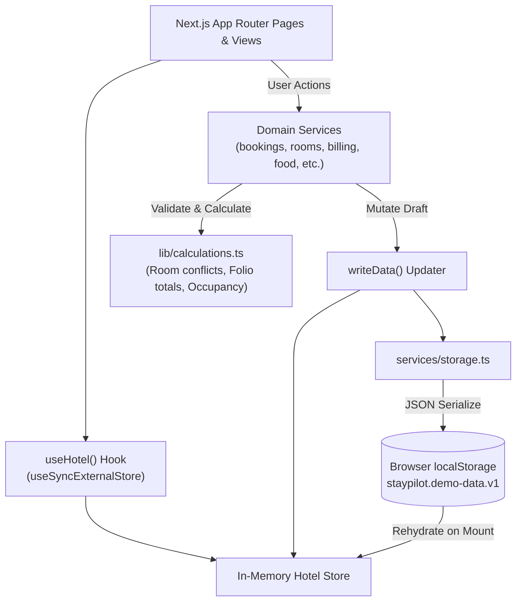

<div align="center">

# StayPilot

**Smarter Hotel Operations. One Unified Dashboard.**

A modern, responsive hotel management dashboard built with Next.js App Router, TypeScript, Tailwind CSS, and shadcn/ui patterns. Designed to streamline front-office check-ins, room inventories, bookings, guest profiles, billing, and housekeeping operations.

Developed as part of the **Cognifyz Technologies Full Stack Web Development Internship**.

---

[](https://nextjs.org/)
[](https://react.dev/)
[](https://www.typescriptlang.org/)
[](https://tailwindcss.com/)
[](https://zod.dev/)
[](https://recharts.org/)
[](https://pnpm.io/)
[](https://vercel.com/)

[Key Features](#key-features) • [Application Pages](#application-pages-and-navigation) • [Architecture](#architecture-and-project-structure) • [Data Model](#data-model-and-persistence) • [Local Setup](#installation-and-local-development) • [Project Roadmap](#backend-integration-and-internship-roadmap)

</div>

---

## Table of Contents

- [About the Project](#about-the-project)
- [Key Features](#key-features)
- [Application Preview](#application-preview)
- [Technology Stack](#technology-stack)
- [Application Pages and Navigation](#application-pages-and-navigation)
- [Architecture and Project Structure](#architecture-and-project-structure)
- [Data Model and Persistence](#data-model-and-persistence)
- [Installation and Local Development](#installation-and-local-development)
- [Demo Access and Usage](#demo-access-and-usage)
- [Available Scripts](#available-scripts)
- [Testing and Verification](#testing-and-verification)
- [Security and Limitations](#security-and-limitations)
- [Backend Integration and Internship Roadmap](#backend-integration-and-internship-roadmap)
- [Deployment](#deployment)
- [License and Acknowledgements](#license-and-acknowledgements)

---

## About the Project

Operating a modern hotel requires balancing complex front-desk logistics, housekeeping turns, guest satisfaction, and financial folios. **StayPilot** provides hotel managers and front-desk teams with a unified workspace that replaces fragmented spreadsheets and disconnected tools.

### Problem Statement
Front-desk staff often struggle with:
1. Overlapping reservations and double-booked rooms during peak seasons.
2. Inaccurate housekeeping statuses causing check-in delays for arriving guests.
3. Disconnected billing where room charges, extra amenities, and taxes are manually tabulated.
4. Fragmented communication between guests, room service, and front-office coordinators.

### Solution
StayPilot centralizes these workflows into an ergonomic, single-pane dashboard. Front-desk personnel can process arrivals and departures in seconds, visualize live room availability, catch scheduling conflicts before confirmation, track housekeeping turnover, and manage billing folios in Indian Rupees (₹) with standardized 12% GST calculations.

> [!NOTE]  
> **Current Project Phase**: StayPilot is currently an advanced, fully interactive **client-side frontend application** backed by an in-memory reactive store, local browser persistence (`localStorage`), simulated network latencies, and comprehensive domain services. It serves as the frontend foundation for the Cognifyz Technologies Full Stack Development internship, with server-side REST APIs and persistent database integrations scheduled in upcoming phases.

---

## Key Features

### Feature Implementation Status Matrix

| Module | Feature Capabilities | Status | Implementation Details |
| :--- | :--- | :---: | :--- |
| **Authentication** | Demo credentials login, password toggle, session persistence | **Implemented & Verified** | Client-side session in `session.ts`, auto-fill demo button |
| **Dashboard** | KPI stat cards, 14-day revenue chart, room status distribution, attention queue | **Implemented & Verified** | Recharts bar chart, live computed aggregations in `calculations.ts` |
| **Bookings** | Create, view, edit, confirm, and cancel reservations | **Implemented & Verified** | `BookingDialog`, `BookingDetailsSheet`, live conflict checks |
| **Front Desk** | Arrivals queue, in-house guests queue, one-click check-in & check-out | **Implemented & Verified** | Auto-generates dirty room state & cleaning task on check-out |
| **Rooms Inventory** | Room cards, live status badges, housekeeping & maintenance toggles | **Implemented & Verified** | Filterable by status (`/rooms?status=...`), manual clean/dirty toggles |
| **Guests Directory** | Searchable guest directory, contact details, VIP badges, preferences | **Implemented & Verified** | Real-time text search across name, email, phone, and city |
| **Housekeeping** | Task priority badges, due time tracking, "Start" and "Complete" lifecycle | **Implemented & Verified** | Completing tasks auto-resets room housekeeping to clean |
| **Billing & Folios** | Invoice table, payment status badges, total and balance calculations | **Partially Implemented** | Read-only invoice view; payment & invoice CRUD in service layer |
| **Room Service** | Food order tracking, sequential order stage advancement | **Partially Implemented** | Move orders `new` → `preparing` → `ready` → `delivered` |
| **Guest Engagement** | Conversation threads, message composer, review flag toggling | **Implemented & Verified** | Thread switching, simulated staff reply sender, star ratings |
| **Global Search** | Command palette (`Ctrl + K` / `Cmd + K`) | **Implemented & Verified** | Real-time search across guests, bookings, rooms, and folios |
| **Notifications** | Live notification popover, unread counter, category filters | **Implemented & Verified** | Filtered by category preferences, mark read, clear |
| **Appearance** | Light and Dark mode switching, density toggle, responsive drawer | **Implemented & Verified** | `next-themes` class toggle with tailored HSL color tokens |

---

## Application Preview

> [!NOTE]  
> High-resolution screenshots can be placed into `public/screenshots/` (e.g. `dashboard.png`, `bookings.png`, `front-desk.png`, `rooms.png`) and referenced here after repository publication.

| Operational Overview | Reservation Management |
| :---: | :---: |
| *(Executive KPIs, 14-Day Revenue Chart & Room Movements)* | *(Interactive Bookings Table, Filters & Details Sheet)* |
| **Front Desk Queue** | **Room Inventory & Housekeeping** |
| *(Arrivals, Departures & Instant Check-in / Check-out)* | *(Floor Layout, Availability Badges & Maintenance Locks)* |

---

## Technology Stack

StayPilot is built with a strictly typed, modern web development stack:

| Technology | Verified Version | Purpose in StayPilot |
| :--- | :--- | :--- |
| **Next.js** | `15.5.18` | React framework, App Router architecture, static page generation |
| **React** | `19.3.1` | UI component rendering, concurrency primitives, hooks |
| **TypeScript** | `5.9.3` | End-to-end static typing, domain interfaces, and strict compiler checks |
| **Tailwind CSS** | `3.4.19` | Utility-first styling, CSS custom properties, and responsive layout grid |
| **shadcn/ui & Radix** | Latest | Accessible UI component primitives (Dialogs, Sheets, Popovers, Tabs, Selects) |
| **Recharts** | `3.10.1` | Interactive, responsive SVG stacked bar charts for revenue visualization |
| **React Hook Form** | `7.91.0` | Controlled and performant form state management |
| **Zod** | `3.25.76` | Schema validation for reservations, guests, rooms, and authentication |
| **date-fns** | `4.1.0` | ISO date calculations, calendar intervals, and duration formatting |
| **Sonner** | `1.7.4` | Rich, responsive toast notifications with action callbacks |
| **next-themes** | `0.4.6` | System-aware client-side dark and light mode persistence |
| **cmdk** | `1.0.4` | Fast, accessible command palette for global search (`Ctrl + K`) |
| **pnpm** | `10.34.8` | Fast, deterministic disk-efficient package management (pinned via Corepack) |

---

## Application Pages and Navigation

The StayPilot frontend implements 13 distinct application routes:

| Route Path | Page Title | Operational Purpose |
| :--- | :--- | :--- |
| `/` | Root Redirect | Automatically routes authenticated visitors to `/dashboard` |
| `/login` | Sign In | Demo sign-in with credential auto-fill, password reveal, and session init |
| `/dashboard` | Dashboard | Executive overview: live occupancy, revenue bar chart, movements, and attention items |
| `/bookings` | Bookings | Reservation list, status filters, table sorting, pagination, and creation modal |
| `/check-in-out` | Front Desk | Daily arrival and departure movements with direct check-in/out triggers |
| `/rooms` | Rooms Inventory | Visual card grid showing room availability, housekeeping states, and maintenance toggles |
| `/guests` | Guest Directory | Directory of registered guests with contact information, stay history, and VIP flags |
| `/housekeeping` | Housekeeping | Schedules for room cleaning, inspection, and maintenance tasks with status actions |
| `/billing` | Billing & Invoices | Folio balance overview, invoice status (paid, partial, draft, overdue), and totals |
| `/food-delivery` | Room Service | Kitchen-to-room order tracker with progressive status transitions |
| `/messages` | Messages | Split-pane guest communication inbox with thread switching and message replies |
| `/reviews` | Reviews | Guest feedback stream with star ratings, origin channel tags, and flag management |
| `/reports` | Reports | High-level summary metrics (collected revenue, booking volume, average rating) |
| `/settings` | Settings | Profile and hotel configuration preferences (property name, currency, check-in policy) |

---

## Architecture and Project Structure

StayPilot adheres to a clean separation of concerns, decoupling presentation components from business logic, data calculations, and storage adapters.

### Directory Layout

```text
StayPilot/
├── app/                          # Next.js App Router root
│   ├── (app)/                    # Authenticated route group with shared AppShell
│   │   ├── billing/page.tsx      # Billing folio view
│   │   ├── bookings/page.tsx     # Reservations management
│   │   ├── check-in-out/page.tsx # Front desk check-in/out queue
│   │   ├── dashboard/page.tsx    # Executive dashboard overview
│   │   ├── food-delivery/page.tsx# Kitchen room-service orders
│   │   ├── guests/page.tsx       # Guest directory
│   │   ├── housekeeping/page.tsx # Cleaning & maintenance tasks
│   │   ├── messages/page.tsx     # Guest messaging inbox
│   │   ├── reports/page.tsx      # Operational summaries
│   │   ├── reviews/page.tsx      # Customer feedback & ratings
│   │   ├── rooms/page.tsx        # Room inventory
│   │   ├── settings/page.tsx     # Property & account settings
│   │   └── layout.tsx            # AppShell wrapper (Header, Sidebar, DataGate)
│   ├── globals.css               # HSL color variables and theme definitions
│   ├── layout.tsx                # Root layout (Fonts, ThemeProvider, Toast container)
│   ├── login/page.tsx            # Demo login page
│   └── page.tsx                  # Home redirect to /dashboard
├── components/                   # UI components
│   ├── app-shell/                # Navigation shell (Sidebar, Header, GlobalSearch, Menus)
│   ├── auth/                     # LoginForm and authentication dialogs
│   ├── bookings/                 # BookingDialog, BookingDetailsSheet, BookingsView
│   ├── dashboard/                # RevenueChart, RoomStatusCard, AttentionCard, MovementsCard
│   ├── front-desk/               # FrontDeskView and DeskCard movements
│   ├── rooms/                    # RoomsView and RoomCard components
│   ├── shared/                   # Generic components (StatusBadge, EmptyState, SortHeader, etc.)
│   └── ui/                       # shadcn/ui Radix primitives (Button, Dialog, Table, Sheet, etc.)
├── services/                     # Business logic and simulated data operations
│   ├── billing-service.ts        # Invoicing, payments, and folio adjustments
│   ├── bookings-service.ts       # Booking lifecycle, room assignment, conflict checks
│   ├── engagement-service.ts     # Messaging, reviews, settings, and demo data reset
│   ├── food-service.ts           # Room service orders and menu availability
│   ├── guests-service.ts         # Guest creation and directory updates
│   ├── rooms-service.ts          # Room inventory, housekeeping, and maintenance tasks
│   ├── storage.ts                # localStorage adapter with versioning and validation
│   └── store.ts                  # Reactive external store with useSyncExternalStore
├── lib/                          # Core utilities, calculations, and data definitions
│   ├── calculations.ts           # Revenue series, room occupancy, conflict algorithms
│   ├── format.ts                 # Currency (INR), date formatting, initials, relative time
│   ├── mock-data.ts              # Deterministic mock dataset generator (24 rooms, 36 guests)
│   ├── navigation.ts             # Navigation hierarchy and menu items
│   ├── session.ts                # Client-side demo session management
│   ├── types.ts                  # TypeScript domain models and interfaces
│   └── validation.ts             # Zod validation schemas
├── hooks/                        # Custom React hooks (useTableState, useAction, useMobile)
├── public/                       # Favicons, icons, and static assets
├── next.config.mjs               # Next.js configuration (unoptimized images, TS settings)
├── package.json                  # Pinned dependencies and packageManager declaration
├── pnpm-lock.yaml                # Deterministic dependency lockfile (v9.0 format)
├── tailwind.config.ts            # Tailwind styling tokens and animation extensions
└── tsconfig.json                 # Strict TypeScript configuration
```

### Data Flow Diagram



---

## Data Model and Persistence

### Domain Entities

StayPilot is modeled around relational hospitality entities defined in [`lib/types.ts`](./lib/types.ts):

- **Room**: `id`, `number`, `type` (*Standard*, *Deluxe*, *Suite*, *Family*), `floor`, `capacity`, `pricePerNight`, `housekeeping` (*clean*, *dirty*, *cleaning*), `maintenance` (boolean).
- **Guest**: `id`, `name`, `email`, `phone`, `city`, `status` (*regular*, *vip*, *inactive*), `preferences`, `notes`.
- **Booking**: `id`, `reference` (`SP-10001`+), `guestId`, `roomId`, `checkIn`, `checkOut`, `adults`, `children`, `ratePerNight`, `extraCharges`, `taxRate`, `status` (*pending*, *confirmed*, *checked_in*, *checked_out*, *cancelled*), `invoiceId`.
- **Invoice & Folio**: `id`, `number` (`INV-2026-xxxx`), `guestId`, `bookingId`, `lineItems`, `taxRate` (12%), `payments` (amount, method, timestamp), `finalized`, `voided`.
- **Housekeeping Task**: `id`, `roomId`, `category` (*housekeeping*, *maintenance*), `type`, `priority` (*low*, *medium*, *high*, *urgent*), `status` (*pending*, *in_progress*, *completed*), `staffId`.
- **Food Order**: `id`, `number` (`RS-1001`+), `roomId`, `guestId`, `items`, `status` (*new*, *preparing*, *ready*, *delivered*, *cancelled*).
- **Conversation & Message**: Threaded guest-to-staff messaging with unread and archived flags.
- **Review**: Star ratings (1–5), reviewer name, origin channel (*Direct survey*, *Website*, *Travel portal*), feedback body, flag status.

### Browser-Based Demo Persistence

- **Storage Key**: `staypilot.demo-data.v1`
- **Rehydration**: On first load, [`services/storage.ts`](./services/storage.ts) inspects browser storage. If empty, corrupted, or outdated, it deterministically seeds fresh records via [`lib/mock-data.ts`](./lib/mock-data.ts).
- **Reactivity**: Changes made through services (`createBooking`, `checkInBooking`, `updateTask`) persist immediately to `localStorage` and notify UI components via `useSyncExternalStore`.
- **Cross-Service Integrity**: Checking out a guest automatically updates the room to `dirty`, creates a housekeeping task, finalizes the invoice, and dispatches a notification.
- **Resetting Demo Data**: Calling `resetDemoData()` resets `localStorage` to fresh factory seed data without leaving the browser.

> [!WARNING]  
> All data lives solely within your browser instance. Changes made on one device or browser profile will not sync to another device.

---

## Installation and Local Development

### Prerequisites

- **Node.js**: `v18.18.0` or higher (verified on Node `v24.13.0`)
- **pnpm**: `v10.0.0` or higher (recommended: `v10.34.8` via Corepack)

### Step-by-Step Setup

1. **Clone the repository**:
   ```bash
   git clone https://github.com/<your-username>/StayPilot.git
   cd StayPilot
   ```

2. **Verify or enable pnpm 10**:
   ```bash
   corepack enable
   pnpm --version
   ```
   *(Ensure pnpm reports `10.x.x` as declared in `package.json`).*

3. **Install project dependencies**:
   ```bash
   pnpm install
   ```

4. **Start the local development server**:
   ```bash
   pnpm dev
   ```

5. **Open in your browser**:
   Navigate to [http://localhost:3000](http://localhost:3000) to view the application.

---

## Demo Access and Usage

StayPilot includes a built-in demo authentication workflow:

1. Navigate to [http://localhost:3000/login](http://localhost:3000/login).
2. Click **"Continue with demo account"** to auto-populate credentials and sign in immediately.
3. *Manual Credentials (Optional)*:
   - **Work Email**: `frontdesk@staypilot.example`
   - **Password**: Any password of 8 or more characters (e.g. `demo-access`)
4. To sign out, click your user avatar in the top-right header and select **Sign out**.

> [!NOTE]  
> Demo authentication is handled locally in the browser to facilitate UI workflow testing. No sensitive passwords, external tokens, or real guest credentials are stored or transmitted.

---

## Available Scripts

The following commands are configured in [`package.json`](./package.json):

```bash
# Start local development server with Turbopack/Webpack
pnpm dev

# Run strict TypeScript type checks across all files
pnpm exec tsc --noEmit

# Compile an optimized production build
pnpm build

# Start the Next.js production server locally
pnpm start

# Run ESLint across source files
pnpm lint
```

---

## Testing and Verification

The StayPilot frontend has undergone baseline verification:

- **TypeScript Compilation**: `pnpm exec tsc --noEmit` passes with **0 errors**.
- **Production Build**: `pnpm build` successfully compiles all **17 static pages** with zero warnings or prerendering failures.
- **End-to-End Verification**: Tested via automated subagent browser runs on `http://localhost:3000`:
  - ✅ Demo authentication and redirect to dashboard.
  - ✅ Reservation creation modal with live night duration and folio estimates.
  - ✅ Real-time conflict detection preventing double-booking of assigned rooms.
  - ✅ Room capacity validation against total adult/child counts.
  - ✅ Slide-over Booking Details Sheet with live status progression.
  - ✅ Reservation editing with automatic invoice line-item re-syncing.
  - ✅ Global Search (`Ctrl + K`) filtering across guests, rooms, and folios.
  - ✅ Light and dark theme switching and mobile sidebar responsiveness.

---

## Security and Limitations

StayPilot is currently designed as a high-fidelity demonstration prototype:

- **Client-Side Auth**: The login screen validates input and writes a session token to `sessionStorage`/`localStorage`. Production deployments require an Express or Next.js backend issuing secure `HttpOnly` session cookies.
- **Isolated Browser Storage**: Demo data is stored locally via `localStorage`. Clearing browser cache will reset records to default seed values.
- **Simulated Payments**: Payments recorded in Billing or during reservation creation simulate real-world ledger records but do not process live monetary transactions.
- **No Production Guarantees**: This codebase is intended for educational, portfolio, and internship demonstration purposes and is not currently hardened for PCI-DSS compliance or GDPR guest data storage.

---

## Backend Integration and Internship Roadmap

This project is structured for the **Cognifyz Technologies Full Stack Web Development Internship**. The completed frontend provides the architectural contract for upcoming backend milestones:

```text
[Current Phase: Frontend Core] ──► [Phase 2: Express REST API] ──► [Phase 3: Database & Auth]
        (Next.js + pnpm)                   (Node.js + REST)                  (PostgreSQL / JWT)
```

- [x] **Task 1 — Core UI Architecture & App Layout**: AppShell navigation, responsive sidebar, and theme switching.
- [x] **Task 2 — Interactive Forms & Validation**: Zod-validated reservation form with room conflict detection.
- [x] **Task 3 — Reactive State & Data Services**: Decoupled service architecture (`bookings-service`, `billing-service`).
- [x] **Task 4 — Multi-Page Operations Workflows**: Front-desk arrivals/departures, room maintenance, and housekeeping lifecycle.
- [x] **Task 5 — Responsive Design & Modern UI**: Recharts data visualization, dark mode, and command search.
- [ ] **Task 6 — Node.js & Express REST Backend**: Swap browser storage adapters for real REST API endpoints (`/api/bookings`, `/api/rooms`).
- [ ] **Task 7 — Database Persistence**: Implement PostgreSQL or MongoDB database models replacing `mock-data.ts`.
- [ ] **Task 8 — Secure Authentication & RBAC**: Implement server-side JWT / HttpOnly session authentication and role-based access for Front Desk vs Management.

---

## Deployment

StayPilot is pre-configured for seamless deployment to **Vercel**:

1. **Push your code to GitHub**:
   ```bash
   git init
   git add .
   git commit -m "feat: complete StayPilot frontend"
   git remote add origin https://github.com/<your-username>/StayPilot.git
   git push -u origin main
   ```
2. **Import into Vercel**:
   - Go to [Vercel Dashboard](https://vercel.com/new).
   - Select the `StayPilot` repository.
   - Vercel automatically detects **Next.js** and respects `"packageManager": "pnpm@10.34.8"` via Corepack.
3. **Build Settings**:
   - **Framework Preset**: Next.js
   - **Build Command**: `pnpm build`
   - **Install Command**: `pnpm install`
4. **Deploy**: Click **Deploy** to generate your live public preview URL.

---

## License and Acknowledgements

### License
This project currently does not have an open-source license specified. All rights are reserved by the author. A formal open-source license (such as MIT) will be designated prior to commercial distribution.

### Acknowledgements
- **Cognifyz Technologies**: For providing the internship curriculum and full stack development specifications.
- **Next.js Team (Vercel)**: For the App Router framework.
- **shadcn**: For the beautifully designed UI component design system.
- **Lucide Icons**: For the clean iconography.

---

<div align="center">
  <sub>Built with care by Chandresh for the Cognifyz Technologies Full Stack Development Internship.</sub>
</div>
